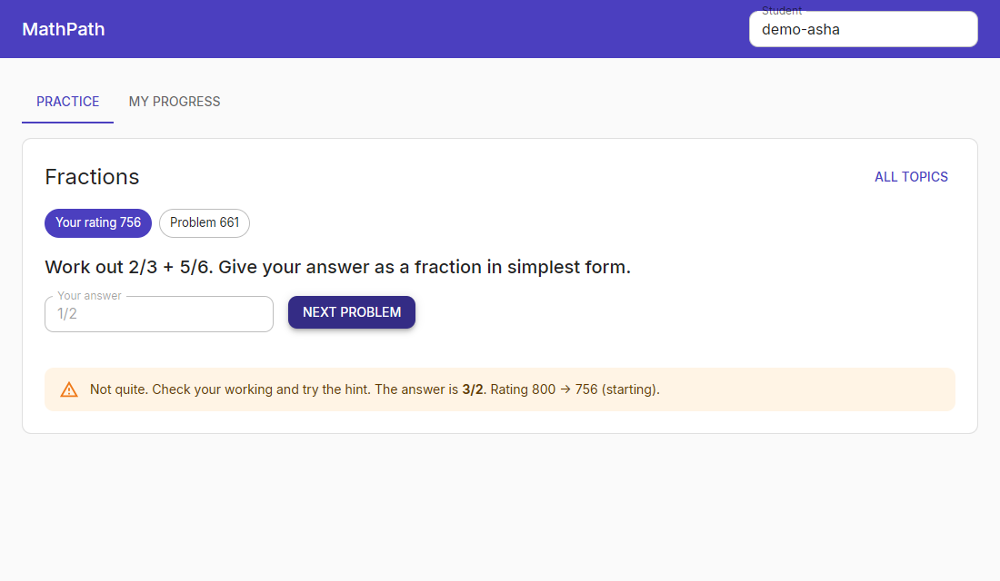

# MathPath: adaptive math practice on Python microservices, DynamoDB and React

A small full-stack EdTech platform for grades 6–8. Students pick a topic, get problems sized to their level, type answers such as `(x+2)(x+3)` or `3/4`, and receive immediate feedback. Their rating per topic is updated after every attempt.

| Part | Stack | What it does |
|---|---|---|
| `content_service/` | **Flask**, pydantic, boto3 | Topic catalogue and problem bank. Public routes never return answer keys. |
| `practice_service/` | **FastAPI**, SymPy, httpx | Picks the next problem, grades the answer and updates the student's rating. |
| DynamoDB | single-table design per service, GSI, transactions | Each service owns one table. Services exchange data only over REST. |
| `web/` | **React 18 + TypeScript + Material-UI (MUI 6)**, Vite, Vitest | Student app: topic grid, practice panel with hints, progress table. |
| `site/` | **Gatsby 5** + TypeScript, GraphQL data layer | Static curriculum site generated from the same seed data, with deep links into the app. |
| `docker-compose.yml` | DynamoDB Local, gunicorn, uvicorn, nginx | One command runs the full stack. |



## Architecture

```
            Gatsby curriculum site ──"Practise this topic"──┐
                                                           ▼
 React + MUI app ──/api/content──► nginx ──► content service (Flask) ──► DynamoDB: mathpath-content
                 └─/api/practice─►       └─► practice service (FastAPI) ──► DynamoDB: mathpath-practice
                                                   │
                                                   └── REST + service token ──► content /internal/problems/{id}
```

* **Service boundaries.** The practice service never reads the content table. It fetches answer keys from the content service's `/internal` route, which requires an `X-Service-Token` (compared in constant time). Calls use a 2 s timeout and retry connection failures. If the content service is down, practice routes return 503 and `/health` stays up.
* **Contract tested over HTTP.** In the tests the practice service calls the real Flask app through `httpx.WSGITransport`, so the cross-service contract is exercised without mocks.

## DynamoDB design

**Content table** (`PK`, `SK`, plus `GSI1`):

| Access pattern | Key |
|---|---|
| List topics in curriculum order | `PK=CATALOG`, `SK begins_with TOPIC#` (SK = `TOPIC#<order>#<slug>`) |
| Topic by slug | `GSI1PK=TOPIC#<slug>`, `GSI1SK=META` |
| Problems near a difficulty | `PK=TOPIC#<slug>`, `SK between P#<lo> and P#<hi>~` (SK = `P#<rating:04d>#<id>`) |
| Problem by id | `GSI1PK=PROBLEM#<id>`, `GSI1SK=PROBLEM` |

Zero-padding the rating in the sort key turns "find a problem of about this difficulty" into one range query instead of a scan.

**Practice table:** `PK=STUDENT#<id>` with `SK=SKILL#<topic>` (rating, attempts, version), `ATTEMPT#<topic>#<ts>#<id>` (log, queried newest first to avoid repeats) and `IDEMP#<attempt id>` (stored response).

Each answer is written with a single **`TransactWriteItems`** call:
1. Put the idempotency key, on condition `attribute_not_exists`. A retried request or double-click replays the stored result instead of counting twice.
2. Append to the attempt log.
3. Put the skill item, on condition `version = :read_version` (optimistic locking). On a conflict the service re-reads and recomputes, up to 3 times.

A test checks that a rejected transaction leaves no partial writes.

## Grading and adaptivity

* **Grading** (`practice_service/grading.py`). Input passes a character and name whitelist and is parsed with SymPy using `evaluate=False`. Chained or large exponents (`9^9^9`) are rejected before evaluation. Answers are compared numerically at random points, so `(x+2)(x+3)`, `x^2+5x+6` and `6+5x+x^2` all count as equal. The misconception `(x+3)^2 = x^2+9` does not. Fraction answers that are correct but not simplified get specific feedback.
* **Adaptivity** (`practice_service/rating.py`). Elo-style rating per student per topic, with a K-factor that shrinks as evidence grows. The next problem targets a predicted **70% success rate**.

`python -m scripts.simulate` runs 2,000 simulated students with known ability (30 attempts each) on the seed bank:

| Policy | Success rate | Rating error after 30 attempts (MAE) |
|---|---|---|
| Random problems | 48.6% | 110 |
| **Adaptive** | **71.4%** (target 70%) | **106** |

Before any attempts, the rating error is 202. So adaptive selection keeps students at the intended difficulty and estimates ability at least as well as random serving. It does not estimate ability much better: the bank is small (192 problems).

## Run it

```bash
docker compose up --build          # app http://localhost:8080, content :5001, practice :8000
```

Without Docker:

```bash
python -m venv .venv && .venv/Scripts/pip install -r requirements-dev.txt "moto[server]"
moto_server -p 8001 &                                # stands in for DynamoDB Local
export DYNAMODB_ENDPOINT=http://127.0.0.1:8001 AWS_ACCESS_KEY_ID=x AWS_SECRET_ACCESS_KEY=x
python -m scripts.bootstrap                          # tables + 6 topics, 192 problems
python -c "from content_service.app import create_app; create_app().run(port=5001)" &
uvicorn practice_service.app:create_app --factory --port 8000 &
cd web && npm ci && npm run dev                      # http://localhost:5173
cd site && npm ci && npm run build                   # static pages in site/public
```

## API

| Service | Route | Notes |
|---|---|---|
| content | `GET /topics`, `GET /topics/{slug}` | |
| content | `GET /topics/{slug}/problems?near=900&exclude=a,b&limit=5` | closest difficulty first |
| content | `POST /topics`, `POST /topics/{slug}/problems` | `X-Admin-Key`; pydantic validation (422), duplicate id (409) |
| content | `GET /internal/problems/{id}` | includes the answer key; `X-Service-Token` |
| practice | `GET /students/{id}/topics/{slug}/next` | problem, rating, target, expected success |
| practice | `POST /students/{id}/attempts` | `{attempt_id, problem_id, answer}`; idempotent on `attempt_id` |
| practice | `GET /students/{id}/progress` | rating, accuracy and mastery per topic |

FastAPI's OpenAPI docs are at `:8000/docs`.

## What was verified

* **46 pytest tests** (grading, rating, both APIs, cross-service calls, idempotency, transaction rollback, outage → 503) against moto's DynamoDB.
* **4 Vitest + Testing Library tests** for the React app. `tsc` and `vite build` pass. The Gatsby `tsc` and `gatsby build` pass (7 static pages, no answer keys in the output).
* A local end-to-end run over real HTTP: moto server as the DynamoDB endpoint, Flask, uvicorn, and the Vite proxy (the screenshot above).
* Not verified locally: the Docker Compose stack (no Docker on the dev machine). CI runs it with an nginx smoke test.
* Out of scope: real authentication (student id is a path parameter) and an admin UI for content.
